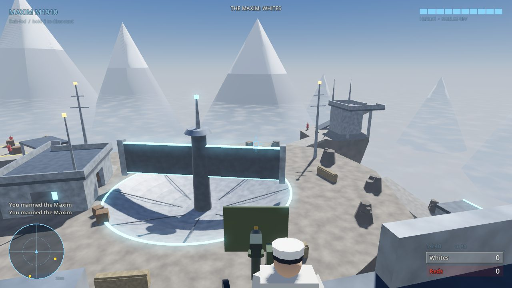
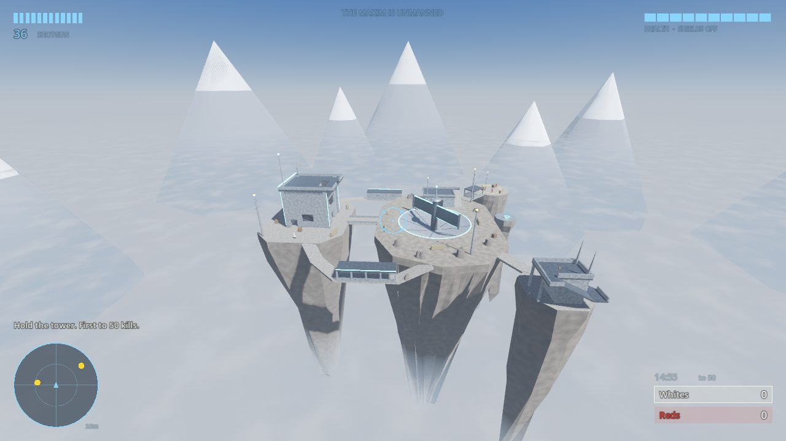
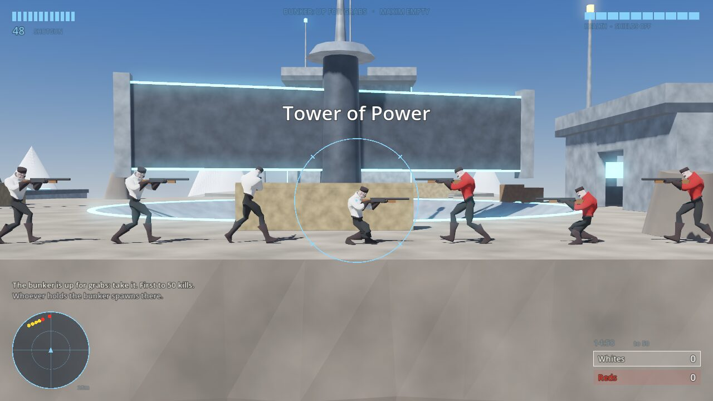

# Mcbeaty Slayer: Tower of Power

A Godot 4 prototype that tries to recreate the feel of Halo 2 multiplayer
and the community gametype **Tower of Power** on **Ascension**. Two teams
fight over one machine gun at the top of the Big Tower. Whoever holds the gun
controls most of the map, so the other team has to storm the tower along the
side paths.

Teams are loosely Russian Civil War: **Whites** in pale greatcoats and peaked
caps, **Reds** in red coats and pointed *budenovka* hats. The turret is a
Maxim M1910 on a wheeled Sokolov mount. All models are crude primitives.



| | |
|---|---|
|  |  |

## Playing it

You don't need Godot to play. Download `McbeatySlayer.exe` and double-click
it. The whole game is packed inside that one file, and nothing gets installed.

The game opens fullscreen on the lobby. Press **Enter** (or click **Deploy**)
to play. F11 switches between fullscreen and a window. Esc pauses and has
**Quit game**.

**The first launch asks for approval once**, because the build isn't signed
with a paid code-signing certificate. Windows shows "Windows protected your
PC": click **More info**, then **Run anyway**. After that it opens with a
normal double-click.

### Making new builds

With Godot 4.3 and its export templates installed, `tools/build.sh` exports
the Windows build into `build/`. The Mac and Linux presets are still there:
`tools/build.sh Windows macOS Linux` builds all three.

### Running from the editor

Install **Godot 4.3** (the standard build, not .NET), choose **Import**,
select `project.godot`, and press **F5**. From a terminal, `godot --path .`
runs it, and `godot --path . -- --autostart` skips the lobby.

### Lobby options

- **Bunker starts with**: your team (defend it) or the Reds (storm it).
- **Red bots** (1–16) and **White bots** (your side, 0–15): up to 16 a side.
- **Score limit**: the 2004 variant used 250. The default here is 50.
- Mouse sensitivity, field of view (Halo 2's is 70° horizontal at 4:3), and
  invert look.

### Controls

| Action | Mouse / keyboard | Gamepad (Halo 2 layout) |
|---|---|---|
| Move / look | WASD / mouse | Left / right stick |
| Fire | Left click | RT |
| Jump | Space | A |
| Melee | F, V or middle click | B |
| Reload | R | X |
| Man / leave the Maxim | Hold E | Hold X |
| Crouch (hides you from the motion tracker) | Ctrl or C | L3 |
| Scoreboard | Tab | Back |
| Pause | Esc | Start |

## The gametype

The rules follow the original 2004 recipe as people remember it: team slayer,
shotgun only, no grenades, no vehicles, **no shields**, and one machine gun
turret placed in one of the towers.

- **Shields off**: 100 health, which slowly regenerates after 6 s without
  taking damage. One melee kills.
- **Shotgun**: 12 shells, 15 pellets, shell-by-shell reload that you can cancel
  by firing. One shot kills out to about 6–7 m. The red reticle comes on
  within 10 m.
- **Maxim**: 600 rounds/min, infinite belt, 72° traverse either side, from
  22° up to 55° down. Third-person camera while you're on it, as with Halo 2
  vehicles. The gunner stays exposed from the sides and from the stairwell
  that comes out right behind them.
- Melee lunge, crouch-jumping, fall damage, a 5 s respawn, kill feed, Halo 2
  multi-kill and spree callouts, and a motion tracker (25 m; it shows enemies
  only while they move upright or fire).

Every number is in [`scripts/core/game_config.gd`](scripts/core/game_config.gd)
if you want to tune the feel.

### The bunker decides where you spawn

The team holding the **gun bunker** (the Big Tower) spawns around it. The
other team spawns on the far side of the map: the south edge of the island,
the Sniper Roost and the Landing Pad. Who holds it, checked every moment:

1. **Whoever is manning the Maxim** holds the bunker, at once.
2. **Gun empty**: if one team outnumbers the holders *inside* the tower (its
   stairwell and deck, with the deck counting double), it takes the bunker
   over 6 seconds. A bigger margin captures faster, up to twice as fast.
3. If the holders match or outnumber them inside, the capture drains away.
4. **Gun empty and tower empty**: the last holder keeps it, so the last team
   to man the gun keeps spawning there.

The bunker spawns sit outside the tower, so holders have to come back in to
defend it. The top of the screen shows who holds the bunker, whether the gun
is manned, and a bar while someone is taking it over.

## The map

The Ascension here is a **hand-built blockout**. I couldn't download the
Halo 2 Vista map files from gruntmods.com: the sandbox this was built in blocks
that site. Instead, the layout follows how the community describes the
original. It has a rocky central island with a dish inset in the ground, and a
rotating antenna that periodically blocks sightlines. Three platforms branch
off it: the Big Tower, the Sniper Roost (the Little Tower with its "fork
prongs"), and the Landing Pad. The Leap of Faith ledge has a teleporter back up.
The Command Center has a walkable roof.

Tower of Power changes the layout in a few places:

- The Maxim sits at the front of the Big Tower deck and covers the island, the
  dish and the centre bridge.
- **West side path**: drops below the island rim and runs under a solid roof
  to the tower's flank, outside the gun's arc. This is the safe route.
- **East side path**: the same, but with two windows the gunner can shoot
  through.
- **Big Tower interior**: a square spiral of four ramps. You come out through
  a hole in the deck just behind the gunner. Murder-hole windows on each
  flight let defenders shoot down at the side paths.

Bots navigate a navmesh baked at startup from the level's collision. Swapping
in real geometry later should be close to drop-in: provide meshes and
colliders, spawn points, routes and the turret transform the way
[`scripts/level/ascension.gd`](scripts/level/ascension.gd) does.

## Bots

The bots are deliberately rudimentary. They fight enemies within about 16 m
and otherwise work the objective:

- **Gun empty**: the two teammates nearest the seat race to man it.
- **Attacking**: they take the west, east or centre route and regroup in
  fours at the end of it before storming the tower.
- **Holding the bunker**: a third of the team guards the tower; the rest hunt
  on the island.

On the gun they sweep its arc, fire in bursts, and hop off when someone flanks
them. Left to themselves at 8 or 16 a side, the holders usually keep the
bunker once they've dug in. That fits Tower of Power's reputation, but it means
taking the gun yourself is the surest way to flip it.

## Tests

Headless checks, run from the project folder (they need the class cache, so
run `godot --headless --path . --import` once first):

```
# Weapons, melee, jump height, fall damage, the turret's arc and lethality,
# and every bunker-control and spawn rule
godot --headless --path . --fixed-fps 60 -s tests/mechanics_test.gd

# A 300 s bot match: navmesh connectivity, a bot mans the Maxim, kills happen,
# and every respawn lands on the side its team is entitled to
godot --headless --path . --fixed-fps 60 -s tests/smoke_test.gd -- reds=16 whites=15

# Screenshots (needs a display; works under xvfb-run)
godot --path . --resolution 1280x720 -s tests/screenshots.gd -- /tmp/shots
```

## Code layout

```
scripts/
  main.gd                   lobby <-> match flow
  core/game.gd              one match: world, spawning, scoring, medals
  core/bunker_control.gd    who holds the gun bunker (and so where each team spawns)
  core/game_config.gd       all tuning numbers + lobby settings
  core/input_setup.gd       keyboard/mouse/gamepad bindings
  level/ascension.gd        the Ascension blockout, spawns, routes, navmesh
  level/level_builder.gd    primitive/mesh/collision helpers
  actors/soldier.gd         Halo-style movement, damage, melee, mounting
  actors/player_controller.gd  input, cameras, shotgun viewmodel
  actors/bot_brain.gd       rudimentary AI
  weapons/shotgun.gd        pellets, falloff, shell reload
  weapons/maxim_turret.gd   the Tower of Power
  ui/hud.gd                 Halo 2-style HUD, tracker, kill feed
  fx/                       particles, tracers and synthesized sounds (no asset files)
```
